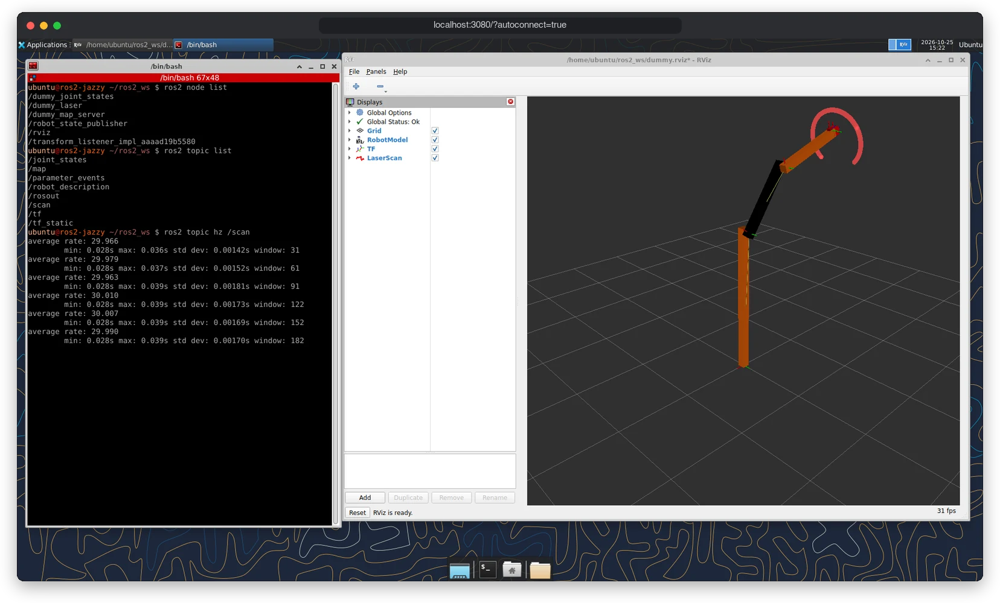
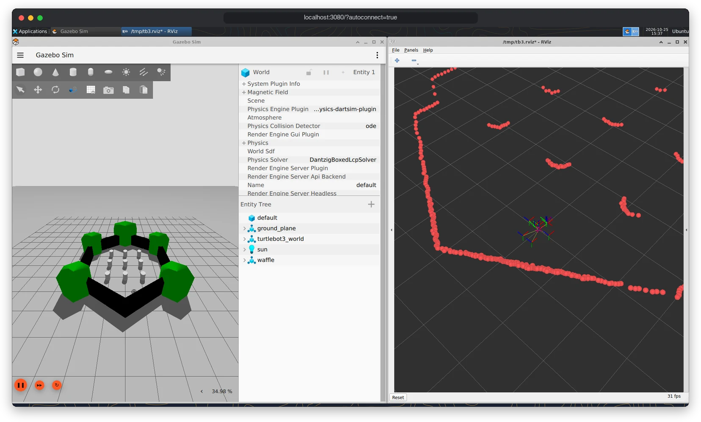

# ROS 2 development containers

[](https://github.com/h3ct0r/ros2_devcontainer_docker_compose/actions/workflows/ci.yml)
[](https://hub.docker.com/r/h3ct0rdcc/ros2_dev)
[](docs/images.md)
[](docs/hosts.md)
[](LICENSE)

Ready-to-use ROS 2 environments for Humble, Jazzy and Lyrical. Each one comes with a desktop in your browser, VS Code, and the same setup on a laptop and on a robot.



## Features

- **Three distros, one setup.** Humble, Jazzy and Lyrical images, built natively for amd64 and arm64 (Apple Silicon, Jetson, ARM servers).
- **Desktop in the browser.** XFCE over noVNC with rviz2 and rqt, plus Gazebo in the `full` image. Nothing to install on the host besides Docker.
- **VS Code ready.** One devcontainer per distro, plus code-server and SSH for working on a robot.
- **Detects your machine.** `./dev.sh` picks networking, devices, NVIDIA GPU and rootless Docker on its own. Any choice can be overridden.
- **Fast rebuilds.** Build output and ccache live in per-distro volumes; colcon defaults to symlink-install, Release and `compile_commands.json`.
- **Multi-machine ROS.** Zenoh (`rmw_zenoh` or `zenoh-bridge-ros2dds`) connects a laptop and a robot across networks, NAT and Docker bridges.

## Quick start

You need Docker: Docker Desktop on macOS, Docker Engine on Linux.

```bash
git clone https://github.com/h3ct0r/ros2_devcontainer_docker_compose.git
cd ros2_devcontainer_docker_compose
./dev.sh up
```

`./dev.sh up` starts the Jazzy desktop image and prints where to connect:

| | |
|---|---|
| Desktop | http://localhost:3080/?autoconnect=true |
| code-server | http://localhost:3081 |
| SSH | `ssh -p 3022 ubuntu@localhost` (password `ubuntu`) |
| Shell | `./dev.sh shell` |

Put your packages in `local_mount/src`; the container sees them as `~/ros2_ws/src`.

**VS Code:** open this folder, run **Dev Containers: Reopen in Container**, then pick **ROS 2 Humble**, **ROS 2 Jazzy** or **ROS 2 Lyrical**.

Another distro or image is one option away:

```bash
./dev.sh up --distro humble                # Humble instead of Jazzy
./dev.sh up --distro lyrical --target full # Lyrical with Gazebo
GPU=none ./dev.sh up                       # ignore the NVIDIA GPU this time
./dev.sh status                            # what was detected, and why
```

## Screenshots

| Simulation (`full`) | Editor (code-server) |
|---|---|
|  |  |
| TurtleBot3 in Gazebo Harmonic, with its laser scan in rviz2. | A C++ node in code-server, built with colcon in the integrated terminal. |

## Images

Images are published to Docker Hub as `h3ct0rdcc/ros2_dev:<distro>-<target>` and mirrored to `ghcr.io/h3ct0r/ros2_dev`. Each target contains the one before it.

| Target | Adds | Compressed size (amd64 / arm64) |
|---|---|---|
| `base` | ROS 2 base, build and debug tools, SSH, Zenoh, Python venv | 1.0–1.2 GB / 0.6–0.8 GB |
| `robot` | perception, Nav2, SLAM Toolbox, robot_localization, RealSense, Livox, Dynamixel, CAN | 2.0–2.5 GB / 1.5–2.0 GB |
| `desktop` (default) | rviz2, rqt, XFCE desktop over noVNC, code-server | 2.3–2.7 GB / 1.8–2.3 GB |
| `full` | `desktop-full`, Gazebo (ros_gz), TurtleBot3 | 2.5–2.8 GB / 1.9–2.3 GB |

| Distro | Ubuntu | Gazebo | Supported until | Tags |
|---|---|---|---|---|
| Humble | 22.04 | Fortress | May 2027 | `humble-base` … `humble-full`, `humble` |
| Jazzy | 24.04 | Harmonic | May 2029 | `jazzy-base` … `jazzy-full`, `jazzy`, `latest` |
| Lyrical | 26.04 | Jetty | May 2031 | `lyrical-base` … `lyrical-full`, `lyrical` |

More in [docs/images.md](docs/images.md).

## Commands

| Command | Does |
|---|---|
| `./dev.sh up` | start the container (default command) |
| `./dev.sh down` | stop and remove it; build volumes are kept |
| `./dev.sh shell` | open a shell in it |
| `./dev.sh status` | show the resolved settings and why |
| `./dev.sh logs` | follow its logs |
| `./dev.sh build` | build the image locally instead of pulling it |

## Documentation

| Guide | Covers |
|---|---|
| [Getting started](docs/getting-started.md) | install, first run, connecting, building your workspace |
| [Configuration](docs/configuration.md) | every setting, `dev.sh`, compose overlays, running several distros |
| [VS Code](docs/vscode.md) | devcontainers per distro, code-server, extensions |
| [Networking and Zenoh](docs/networking.md) | ROS discovery, connecting a laptop to a robot |
| [Hosts and hardware](docs/hosts.md) | macOS, Linux, NVIDIA, Jetson, rootless Docker, USB devices |
| [Images](docs/images.md) | targets, tags, distro differences, building locally |
| [Troubleshooting](docs/troubleshooting.md) | common problems and their fixes |
| [Development](docs/development.md) | repo layout, adding packages or distros, CI and publishing |
| [Migration](docs/migration.md) | coming from `ros2_humble_docker_vnc_dev` or the old compose files |

## License

[MIT](LICENSE)
