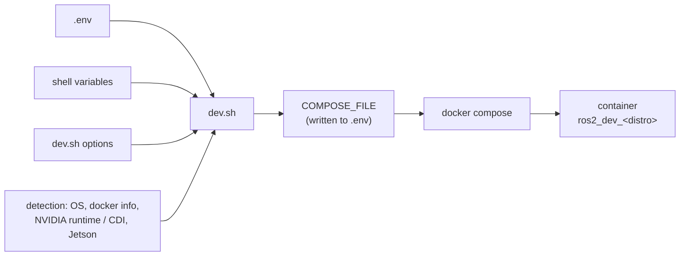

# Configuration

Every choice is a setting in `.env` at the repo root. `./dev.sh`, plain `docker compose` and the VS Code devcontainers all read it. [.env.example](../.env.example) lists every setting with its default; `./dev.sh` copies it to `.env` the first time.

## Where settings come from

From lowest to highest priority:

1. the defaults in `dev.sh`;
2. `.env`;
3. a variable in your shell, e.g. `GPU=none ./dev.sh up`;
4. a `dev.sh` option, e.g. `./dev.sh up --gpu none`.

`ROS_DISTRO` is the exception: it is only read from `.env` and `--distro`. A host shell that sourced ROS exports its own `ROS_DISTRO`, which must not pick the container's distro.

`./dev.sh status` shows what each setting resolved to and why:

```text
$ ./dev.sh status
ROS jazzy, image h3ct0rdcc/ros2_dev:jazzy-desktop, Docker 29.1.3 on Darwin
  ROS_DISTRO  jazzy          (default)
  TARGET      desktop        (default)
  GPU         none           (auto: macOS)
  MODE        rootful        (auto: Docker runs as root)
  NETWORK     bridge         (auto: Docker Desktop on macOS)
  DEVICES     none           (auto: macOS)
  PLATFORM    native         (default)
  compose     compose.yaml compose/net-bridge.yaml compose/macos.yaml
```

## Image and host settings

| Setting | Values | Default | `auto` picks |
|---|---|---|---|
| `ROS_DISTRO` | `humble`, `jazzy`, `lyrical` | `jazzy` | – (in VS Code, the devcontainer you open decides) |
| `TARGET` | `base`, `robot`, `desktop`, `full` | `desktop` | – |
| `GPU` | `auto`, `none`, `nvidia`, `jetson` | `auto` | `jetson` on a Jetson; `nvidia` if Docker has the NVIDIA runtime or an NVIDIA CDI spec exists; otherwise `none` |
| `MODE` | `auto`, `rootful`, `rootless` | `auto` | `rootless` if `docker info` says so |
| `NETWORK` | `auto`, `host`, `bridge` | `auto` | `bridge` on macOS and on rootless Docker older than 29.5; `host` on other Linux hosts |
| `DEVICES` | `auto`, `none`, `all` | `auto` | `all` on rootful Linux; `none` on macOS and rootless |
| `PLATFORM` | `native`, `linux/amd64`, `linux/arm64` | `native` | – (the non-native one runs under emulation) |

Any value other than `auto` wins over the detection. For example, on an NVIDIA machine:

```bash
GPU=none ./dev.sh up        # once
echo GPU=none >> .env       # from now on
```

## Runtime settings

These go straight to the container.

| Setting | Default | What it does |
|---|---|---|
| `ROS_DOMAIN_ID` | `0` | ROS domain |
| `ROS_DISCOVERY` | `subnet` | `subnet` or `localhost`; see [Networking](networking.md#discovery-range) |
| `ROS_TRANSPORT` | `dds` | `dds`, `zenoh` or `bridge`; see [Networking](networking.md#zenoh) |
| `ZENOH_CONNECT` | empty | Zenoh endpoints to join, e.g. `tcp/192.168.1.50:7447` |
| `ZENOH_NAMESPACE` | empty | `bridge` only: prefix for everything this host shares, e.g. `/bot1` |
| `DEV_PASSWORD` | `ubuntu` | SSH password of `ubuntu` (or `root` in rootless mode) |
| `VNC_PASSWORD` | empty | desktop password; empty means no password |
| `CODE_SERVER_PASSWORD` | empty | code-server password; empty means no password |
| `NOVNC_PORT`, `CODE_SERVER_PORT`, `SSH_PORT`, `VNC_PORT`, `ZENOH_PORT` | `3080`, `3081`, `3022`, `5902`, `7447` | host ports with bridge networking |
| `TZ` | `UTC` | container time zone |
| `RESTART` | `no` | `unless-stopped` starts the container again after a reboot, e.g. on a robot |
| `WORKSPACE` | `./local_mount` | host folder mounted as `~/ros2_ws` |
| `IMAGE` | `h3ct0rdcc/ros2_dev` | image repository, e.g. `ghcr.io/h3ct0r/ros2_dev` |

Changes take effect on the next `./dev.sh up`, which recreates the container if needed.

## Commands

```text
./dev.sh [command] [options]

  up         start the container (default)
  down       stop and remove it (build volumes are kept)
  shell      open a shell in the running container
  status     show the selected settings and why
  logs       follow the container's logs
  build      build the image locally instead of pulling it
  configure  only record the selection in .env, or with --output FILE write the
             merged compose file there (used by the devcontainers)

  --distro humble|jazzy|lyrical     --target base|robot|desktop|full
  --gpu auto|none|nvidia|jetson     --mode auto|rootful|rootless
  --network auto|host|bridge        --devices auto|none|all
  --platform native|linux/amd64|linux/arm64
```

## How it works

[compose.yaml](../compose.yaml) defines one service, `ros2`. Each host concern is a small overlay in [compose/](../compose). `dev.sh` resolves the settings, then picks the overlays:



| Overlay | Added when | Does |
|---|---|---|
| `net-host.yaml` | `NETWORK=host` | host network and IPC: DDS multicast, SocketCAN, no port mapping |
| `host-pid.yaml` | `NETWORK=host` and rootful | host PID namespace, so Fast DDS shared memory can see peers on the host |
| `net-bridge.yaml` | `NETWORK=bridge` | publishes the ports, 1 GB `/dev/shm` |
| `devices.yaml` | `DEVICES=all` | `privileged` and the host's `/dev` |
| `rootless.yaml` | `MODE=rootless` | runs the container as root, which is your host user |
| `gpu-nvidia.yaml` | `GPU=nvidia` | requests all NVIDIA GPUs |
| `gpu-jetson.yaml` | `GPU=jetson` | the `nvidia` runtime from JetPack (experimental) |
| `x11-host.yaml` | Linux | the host's X11 socket and cookie, for GUI apps on your screen |
| `macos.yaml` | macOS | GUI apps open on the browser desktop (`DISPLAY=:2`) |
| `platform.yaml` | `PLATFORM` isn't `native` | runs the other architecture under emulation |

`dev.sh up` appends the chosen list to `.env` between `# >>> written by ./dev.sh` markers, as `COMPOSE_FILE`. Plain `docker compose ps`, `logs`, `pull` and `down` then use the same selection. Don't edit that block; it's rewritten on every run.

Run plain `docker compose` from a host shell without ROS sourced. A sourced shell exports `ROS_DISTRO`, which plain compose would use over `.env`. `./dev.sh` doesn't have this problem.

## Several distros side by side

Each distro is its own compose project: `ros2_dev_humble`, `ros2_dev_jazzy` and `ros2_dev_lyrical`. Each has its own container, hostname (`ros2-<distro>`) and build volumes:

```bash
./dev.sh up --distro jazzy
./dev.sh up --distro humble
```

With host networking (Linux) the services of both containers would use the same ports, so run the desktop on one of them only, or use bridge networking. With bridge networking (macOS), give the second one other host ports in its shell:

```bash
NOVNC_PORT=4080 CODE_SERVER_PORT=4081 SSH_PORT=4022 VNC_PORT=5903 ZENOH_PORT=7448 \
  ./dev.sh up --distro humble
```

`./dev.sh down --distro humble` stops that one.
