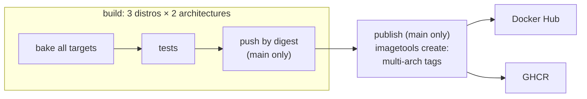

# Development

This page is for changing the images or this repo: adding packages, adding a distro, and how CI publishes.

## Repo layout

```text
docker/
  Dockerfile          one Dockerfile for every distro; targets base, robot, desktop, full
  entrypoint.sh       user, passwords, middleware and discovery at container start
  packages/           apt packages per target, distro and architecture
  python/             pip requirements for the ~/.py3 venv
configs/              files copied into the image: bash, colcon, supervisord, VNC, XFCE, Zenoh, udev
compose.yaml          the service; compose/ holds the per-host overlays
dev.sh                resolves the settings and runs docker compose
.devcontainer/        one VS Code config per distro, plus initialize.sh
docker-bake.hcl       every image as <distro>-<target>, with tags and pinned base images
.github/workflows/    CI: build, test and publish
third_party_pkgs/     vendored sources (Livox SDK2)
local_mount/          your workspace (ignored by git, except its README)
docs/                 this documentation
```

## Adding an apt package

Package lists live in [docker/packages/](../docker/packages), one file per target:

| File | Installed into |
|---|---|
| `<target>.txt` | that target, for every distro |
| `<target>.<distro>.txt` | that target, for one distro |
| `<target>.<distro>.<arch>.txt` | that target, for one distro and architecture (`amd64`, `arm64`) |

One package per line; `#` starts a comment. `@name` expands to `ros-<distro>-name`:

```text
# docker/packages/robot.txt
@slam-toolbox          # ros-jazzy-slam-toolbox on Jazzy
can-utils
```

[install.sh](../docker/packages/install.sh) reads the files for the target being built. Put a package in the lowest target that needs it, since later targets include it. Check that it exists for every distro and both architectures, for example at [index.ros.org](https://index.ros.org) or with `apt-cache policy` in each image. If it doesn't, use a per-distro file.

Python packages go in [docker/python/requirements.txt](../docker/python/requirements.txt), or `requirements.<distro>.txt` for one distro. The venv is constrained to the system's numpy major version, so ROS's compiled modules keep working.

Then build and try it:

```bash
./dev.sh build --distro jazzy --target robot
./dev.sh up --distro jazzy --target robot
```

## Adding a distro

1. Add the base image, pinned by digest, to `base_image` in [docker-bake.hcl](../docker-bake.hcl), and the distro to the `image` matrix and a group.
2. Add `<target>.<distro>.txt` and `requirements.<distro>.txt` files for packages that differ.
3. Add the distro to `check ROS_DISTRO` in [dev.sh](../dev.sh).
4. Copy a folder in [.devcontainer/](../.devcontainer) and change the distro in it.
5. Add the distro to the CI matrix and to the publish loop in [ci.yml](../.github/workflows/ci.yml).
6. Build every target on both architectures, then check the desktop, rviz2 and Gazebo.

Things that changed between distros so far: a base image that already has the `ubuntu` user, the discovery variable (`ROS_LOCALHOST_ONLY` before Jazzy), TigerVNC's config folder, and XFCE's wallpaper settings. The Dockerfile and [vnc_run.sh](../configs/vnc/vnc_run.sh) handle each one.

## CI and publishing

[ci.yml](../.github/workflows/ci.yml) runs on GitHub's hosted runners, natively on amd64 (`ubuntu-24.04`) and arm64 (`ubuntu-24.04-arm`):



| Event | What happens |
|---|---|
| Pull request to `main` | build and test every distro on both architectures; nothing is published |
| Push to `main` | same; if the push changed what goes into the images, also push each image by digest and create the multi-arch tags on Docker Hub and GHCR |
| Manual run (`workflow_dispatch`) on `main` | build, test and publish, whatever changed |

The tests in each job:
- the base tools (`ros2`, `colcon`, Open3D, `rclpy`, the Zenoh bridge) and `cv_bridge` in the venv;
- Zenoh between two containers;
- `./dev.sh up` with the desktop: noVNC, code-server and SSH answer;
- the discovery variable is the right one for the distro.

CI runs only when files that affect the images or the setup change: `docker/`, `configs/`, `third_party_pkgs/`, the compose files, `dev.sh`, `docker-bake.hcl` or the workflow. Documentation changes don't run it.

On `main`, only changes to `docker/`, `configs/`, `third_party_pkgs/`, `docker-bake.hcl` or the workflow publish new images. A push that only touches `dev.sh` or the compose files is built and tested but not published, since those files aren't part of the images. That keeps the tags from moving to rebuilt but identical images, and keeps Docker Hub requests down; two full publishes in a row can hit its rate limit (HTTP 429).

**Secrets** (repository settings → Secrets and variables → Actions):

| Secret | Used for |
|---|---|
| `DOCKERHUB_USERNAME` | Docker Hub login |
| `DOCKERHUB_TOKEN` | Docker Hub access token with write access, for pushing images |
| `DOCKERHUB_DESCRIPTION_TOKEN` | Docker Hub token with read, write and delete access, for updating the repository overview |

GHCR uses the workflow's own `GITHUB_TOKEN`.

The Docker Hub overview comes from [docs/dockerhub.md](dockerhub.md) and is updated by [dockerhub.yml](../.github/workflows/dockerhub.yml) when that file changes on `main`.

## Releasing

There are no version tags: every merge to `main` that changes the images publishes new images under the same tags. To publish again without code changes, run the workflow by hand from the Actions tab.

Builds reuse cached layers, so a rerun doesn't fetch newer ROS packages by itself. To pick up upstream updates, move the base image digests in [docker-bake.hcl](../docker-bake.hcl) to the current `ros:<distro>-ros-base-<ubuntu>` images; that rebuilds every layer.
