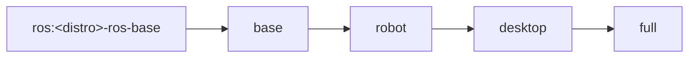

# Images

One [Dockerfile](../docker/Dockerfile) builds four targets for each distro, for amd64 and arm64. Each target adds to the one before it:



| Target | Adds | Use it for |
|---|---|---|
| `base` | build and debug tools (colcon, rosdep, gdb, ccache, ament lint), SSH, rmw_zenoh, CycloneDDS, zenoh-bridge-ros2dds, Python venv `~/.py3` with Open3D and SciPy | headless development, CI |
| `robot` | perception, Nav2, SLAM Toolbox, robot_localization, spatio-temporal voxel layer, RealSense, Livox SDK2, Dynamixel, SocketCAN, teleop | running on the robot |
| `desktop` | ROS `desktop` (rviz2, rqt), Nav2 rviz plugins, XFCE over TigerVNC and noVNC, code-server | development with a GUI |
| `full` | ROS `desktop-full`, Gazebo through `ros_gz`, MuJoCo (`mujoco_vendor`, `mujoco_ros2_control` and its demos, the `mujoco` Python bindings with the viewer), TurtleBot3, ffmpeg, PCL tools | simulation |

The exact apt packages of each target are listed in [docker/packages/](../docker/packages), and the Python packages in [docker/python/](../docker/python).

## Distros

| Distro | Base image | Ubuntu | Python | Gazebo | Supported until |
|---|---|---|---|---|---|
| Humble | `ros:humble-ros-base-jammy` | 22.04 | 3.10 | Fortress | May 2027 |
| Jazzy | `ros:jazzy-ros-base-noble` | 24.04 | 3.12 | Harmonic | May 2029 |
| Lyrical | `ros:lyrical-ros-base-resolute` | 26.04 | 3.14 | Jetty | May 2031 |

The base images are pinned by digest in [docker-bake.hcl](../docker-bake.hcl).

**Per-distro differences**
- **Humble:** the TurtleBot3 Gazebo Classic simulations are only packaged for amd64. On arm64, pip installs `ros2_unbag` 1.0.x, because newer releases need glibc 2.39.
- **Lyrical:** there's no `turtlebot3` metapackage yet; its simulations are installed. `ros2_unbag` is left out because it pins numpy 1.26, which has no Python 3.14 wheels.
- **Python venv:** numpy stays on the system's major version (1 on Humble and Jazzy, 2 on Lyrical), so ROS's compiled extensions such as `cv_bridge` keep working inside the venv.

## Tags

Images are published to Docker Hub and mirrored to the GitHub Container Registry:

| Tag | Points to |
|---|---|
| `h3ct0rdcc/ros2_dev:<distro>-<target>` | that distro and target, e.g. `jazzy-desktop` |
| `h3ct0rdcc/ros2_dev:<distro>` | `<distro>-full` |
| `h3ct0rdcc/ros2_dev:latest` | `jazzy-full` |
| `ghcr.io/h3ct0r/ros2_dev:<same tags>` | the same images |

Every tag is multi-arch (amd64 + arm64); Docker pulls the right one.

Until Humble's end of life, the Humble images are also published under their old names: `h3ct0rdcc/ros2_humble_development:{base,robot,desktop,full,latest}`, plus the single-arch `:amd64` and `:arm64`.

## Sizes

Compressed download size from Docker Hub, in GB:

| | amd64 | arm64 |
|---|---|---|
| `humble-base` / `jazzy-base` / `lyrical-base` | 1.2 / 1.2 / 1.0 | 0.8 / 0.8 / 0.6 |
| `humble-robot` / `jazzy-robot` / `lyrical-robot` | 2.0 / 2.3 / 2.5 | 1.5 / 1.8 / 2.0 |
| `humble-desktop` / `jazzy-desktop` / `lyrical-desktop` | 2.3 / 2.6 / 2.7 | 1.8 / 2.1 / 2.3 |
| `humble-full` / `jazzy-full` / `lyrical-full` | 2.5 / 2.7 / 2.8 | 1.9 / 2.2 / 2.3 |

Targets share layers: pulling `desktop` after `robot` downloads only the difference.

## What runs in the container

[supervisord](../configs/supervisord) starts the services:

| Service | Port | Image | Started when |
|---|---|---|---|
| sshd | 3022 | all | always |
| TigerVNC (display `:2`) + noVNC | 5902, 3080 | `desktop`, `full` | always |
| code-server | 3081 | `desktop`, `full` | always |
| Zenoh router | 7447 | all | `ROS_TRANSPORT=zenoh` |
| zenoh-bridge-ros2dds | 7447 | all | `ROS_TRANSPORT=bridge` |

The [entrypoint](../docker/entrypoint.sh) runs first. It picks the user (`ubuntu`, or `root` under rootless Docker), sets the passwords, selects the ROS middleware and discovery variables, and sources ROS and the workspace.

## Building locally

`./dev.sh build` builds the image for the current selection, for this machine's architecture:

```bash
./dev.sh build --distro lyrical --target desktop
./dev.sh up --distro lyrical --target desktop      # uses the local image
```

[docker-bake.hcl](../docker-bake.hcl) defines every image as `<distro>-<target>`:

```bash
docker buildx bake --load --set '*.platform=linux/arm64' jazzy-desktop  # one image
docker buildx bake jazzy                                                 # all of Jazzy's targets
docker buildx bake --print release                                       # everything CI publishes
```

Local builds reuse the layers CI has already built: they read the registry cache that CI pushes for each distro and architecture (`h3ct0rdcc/ros2_dev:buildcache-<distro>-<arch>`). apt downloads stay in BuildKit cache mounts, so rebuilding after a package-list change is quick. See [Development](development.md) for changing what goes into an image.
