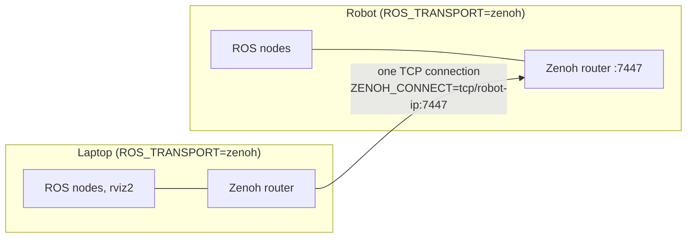

# Networking and Zenoh

## Host or bridge networking

| | Host networking | Bridge networking |
|---|---|---|
| Used on | Linux (rootful, or rootless Docker 29.5+) | macOS; rootless Docker before 29.5 |
| ROS discovery with other machines | DDS multicast works on the LAN | stays inside Docker; use [Zenoh](#zenoh) |
| ROS nodes on the same host | talk to the container directly | not reachable over DDS |
| Ports | the container's services listen on the host | published: 3080, 3081, 3022, 5902, 7447 |
| SocketCAN, raw sockets | yes | no |

`./dev.sh` picks one; `NETWORK=host` or `NETWORK=bridge` in `.env` overrides it.

## Discovery range

`ROS_DISCOVERY` sets how far DDS discovery reaches, in the form each distro understands:

| `ROS_DISCOVERY` | Humble gets | Jazzy and Lyrical get |
|---|---|---|
| `subnet` (default) | nothing; Humble's setup sets `ROS_LOCALHOST_ONLY=0` | `ROS_AUTOMATIC_DISCOVERY_RANGE=SUBNET` |
| `localhost` | `ROS_LOCALHOST_ONLY=1` | `ROS_AUTOMATIC_DISCOVERY_RANGE=LOCALHOST` |

Only the variable the distro reads is set. Jazzy warns when it sees `ROS_LOCALHOST_ONLY`, and Lyrical ignores it. For compatibility, `ROS_LOCALHOST_ONLY=1` as input still means `localhost`.

Use `ROS_DOMAIN_ID` to keep several robots or developers on one network apart.

## Zenoh

Zenoh carries ROS traffic over a single TCP connection. It works where DDS discovery doesn't: across subnets, Wi-Fi with multicast blocked, VPNs, NAT and Docker bridge networks. It's off by default; `ROS_TRANSPORT` turns it on:

| `ROS_TRANSPORT` | ROS nodes use | Also started in the container | Use when |
|---|---|---|---|
| `dds` (default) | Fast DDS | – | one machine, or a LAN where DDS discovery works |
| `zenoh` | `rmw_zenoh_cpp` | a Zenoh router on TCP 7447 | every node on every machine can use rmw_zenoh |
| `bridge` | CycloneDDS | `zenoh-bridge-ros2dds` on TCP 7447 | nodes keep DDS locally; only the bridge crosses the network |

### Laptop to robot



On the robot:

```bash
ROS_TRANSPORT=zenoh ./dev.sh up --target robot
```

On the laptop:

```bash
ROS_TRANSPORT=zenoh ZENOH_CONNECT=tcp/<robot-ip>:7447 ./dev.sh up
```

Then `ros2 topic list` on the laptop shows the robot's topics. Only the laptop needs to reach the robot; the robot never connects back. That's why this works from behind NAT, from a bridge network, and from rootless Docker.

`ZENOH_CONNECT` takes a comma-separated list, e.g. `tcp/10.0.0.5:7447,tcp/10.0.0.6:7447`.

### Bridge mode and namespaces

With `ROS_TRANSPORT=bridge`, the robot's nodes stay on plain DDS (CycloneDDS), and `zenoh-bridge-ros2dds` forwards topics, services and actions over Zenoh. Use it when some nodes can't switch middleware, e.g. drivers in another container or a vendor stack.

`ZENOH_NAMESPACE` prefixes everything a host shares, which keeps several robots apart:

```bash
# robot 1
ROS_TRANSPORT=bridge ZENOH_NAMESPACE=/bot1 ./dev.sh up --target robot
# laptop
ROS_TRANSPORT=bridge ZENOH_CONNECT=tcp/<bot1-ip>:7447 ./dev.sh up
```

On the laptop, `/bot1/cmd_vel` is `/cmd_vel` on robot 1.

The bridge honors `ROS_DOMAIN_ID` and `ROS_DISCOVERY=localhost`. rmw_zenoh ignores both discovery-range variables.

## Ports

| Port | Service | Image |
|---|---|---|
| 3022 | SSH | all |
| 3080 | noVNC (desktop in the browser) | `desktop`, `full` |
| 3081 | code-server | `desktop`, `full` |
| 5902 | VNC | `desktop`, `full` |
| 7447 | Zenoh router or bridge | all, with `ROS_TRANSPORT=zenoh` or `bridge` |

With bridge networking, `NOVNC_PORT`, `CODE_SERVER_PORT`, `SSH_PORT`, `VNC_PORT` and `ZENOH_PORT` change the host side.
