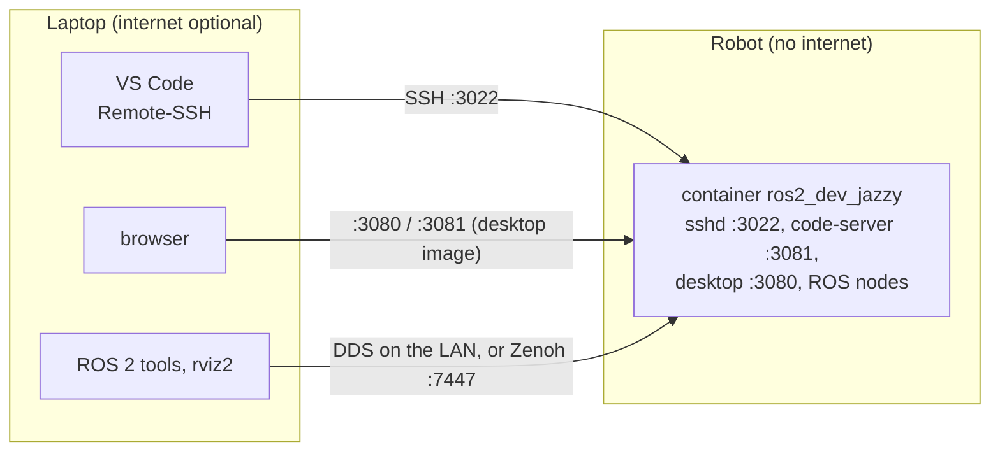

# Running on a robot

This guide puts the container on a robot and works with it from a laptop. Nothing in it needs the robot to reach the internet: the image and repo are copied over from the laptop, and VS Code's server comes from the laptop too.



## 1. Pick the image

| Image | On the robot you get | Size (arm64) |
|---|---|---|
| `robot` | drivers, Nav2, SLAM, SSH; no GUI | about 1.8 GB |
| `desktop` | the above plus code-server and the browser desktop | about 2.1 GB |

Use `robot` unless you want to edit or view things in a browser on the robot itself. Either way, VS Code on the laptop connects over SSH.

Check the robot's architecture: `ssh robot uname -m` prints `aarch64` for arm64 (Jetson, Raspberry Pi) or `x86_64` for amd64.

## 2. Copy the image and the repo

If the robot has internet once, `git clone` and `docker pull` there, and skip to step 3.

Otherwise, on the laptop, download the image for the robot's architecture and stream it over SSH:

```bash
docker pull --platform linux/arm64 h3ct0rdcc/ros2_dev:jazzy-robot
docker save h3ct0rdcc/ros2_dev:jazzy-robot | ssh robot docker load
```

With no network between the two, use a file and a USB drive:

```bash
docker save h3ct0rdcc/ros2_dev:jazzy-robot | gzip > ros2_dev_jazzy-robot.tar.gz   # laptop
docker load < ros2_dev_jazzy-robot.tar.gz                                          # robot
```

Copy the repo the same way, with your workspace in `local_mount/src`:

```bash
rsync -a --exclude .git/ ./ robot:ros2_devcontainer_docker_compose/
```

## 3. Start it

On the robot:

```bash
cd ros2_devcontainer_docker_compose
echo TARGET=robot >> .env
echo RESTART=unless-stopped >> .env   # come back after a reboot
./dev.sh up
```

`./dev.sh up` only talks to the local Docker daemon. Compose uses the image already on the robot and never checks Docker Hub for a newer one. The VS Code devcontainer tool does the same: it looks for the image locally and only goes online if it's missing. If something tries to download, the image on the robot doesn't have the exact name `h3ct0rdcc/ros2_dev:<distro>-<target>` that `./dev.sh status` shows.

With `RESTART=unless-stopped`, Docker starts the container again after a reboot, until you run `./dev.sh down`. Docker itself must start at boot: `sudo systemctl enable docker`.

## 4. Connect from the laptop

### SSH and VS Code

The container's SSH server listens on port 3022 of the robot. Add it to `~/.ssh/config` on the laptop:

```text
Host robot-ros
    HostName 192.168.1.50
    Port 3022
    User ubuntu
```

`ssh robot-ros` then opens a shell in the container (password `ubuntu`, or `DEV_PASSWORD`). Copy your key with `ssh-copy-id robot-ros` to skip the password.

In VS Code, install the **Remote - SSH** extension and add these to your user settings:

```json
{
    "remote.SSH.localServerDownload": "always",
    "remote.downloadExtensionsLocally": true
}
```

Then run **Remote-SSH: Connect to Host…** → `robot-ros` and open `/home/ubuntu/ros2_ws`.

With these two settings, the laptop downloads the VS Code server and your extensions, then copies them to the robot over SSH. The robot doesn't need the internet; the laptop does, the first time. The server lands in `~/.vscode-server`, a Docker volume (`ros2_dev_<distro>_vscode`), so it survives `./dev.sh down`, container updates and reboots. After the first connection, the laptop can be offline too, as long as VS Code stays on the same version.

Remote-SSH to the container is better than a devcontainer on a robot: nothing builds or recreates containers, and the robot doesn't need the repo's VS Code setup.

### Browser

With the `desktop` image, open http://192.168.1.50:3080/?autoconnect=true for the desktop and http://192.168.1.50:3081 for code-server. Both are part of the image and work without internet. Set `VNC_PASSWORD` and `CODE_SERVER_PASSWORD` on a shared network.

### ROS

The robot uses host networking, so ROS nodes on the laptop see it over DDS when both are on the same LAN with the same `ROS_DOMAIN_ID`. Across Wi-Fi without multicast, NAT or a VPN, use Zenoh; see [Networking](networking.md#laptop-to-robot).

## 5. Your workspace's dependencies

Packages installed with `rosdep` or `apt` inside the container are lost when the container is recreated, e.g. after an image update or a settings change. Offline, you can't install them again. Instead, build an image that already has them, on the laptop.

Save this as `Dockerfile.robot` next to the repo, or anywhere:

```dockerfile
ARG BASE=h3ct0rdcc/ros2_dev:jazzy-robot
FROM ${BASE}
# The workspace sources are only mounted for rosdep, not copied into the image
RUN --mount=type=bind,source=.,target=/tmp/src \
    sudo apt-get update \
    && rosdep install --from-paths /tmp/src --ignore-src -y -r \
    && sudo rm -rf /var/lib/apt/lists/*
```

Build it for the robot with your workspace's `src` as the build context, and tag it with the same `<distro>-<target>` name:

```bash
docker buildx build --platform linux/arm64 -f Dockerfile.robot \
  -t myrobot:jazzy-robot --load local_mount/src
docker save myrobot:jazzy-robot | ssh robot docker load
```

On the robot, point `IMAGE` at it:

```bash
echo IMAGE=myrobot >> .env
./dev.sh up
```

Rebuild it when your `package.xml` dependencies change.

## 6. Building and running

In the container on the robot (`ssh robot-ros`):

```bash
cd ~/ros2_ws
colcon build
source install/setup.bash
ros2 launch my_robot bringup.launch.py
```

Builds, the install space and ccache live in Docker volumes on the robot, so they survive restarts. To start nodes automatically with the container, launch them from a script on the robot, e.g. `docker exec -d ros2_dev_jazzy bash -lc 'ros2 launch my_robot bringup.launch.py'` from a systemd unit that runs after Docker.

## 7. Updating

Repeat step 2 with the new image, then `./dev.sh up` on the robot; it recreates the container with the new image and keeps the volumes. Free the old image's space with `docker image prune`.

## Without internet, these don't work

| What | Why | Instead |
|---|---|---|
| `sudo apt-get update`, `rosdep install` | need the package servers | bake dependencies into the image (step 5) |
| The devcontainer's first start (`postCreate.sh`) | runs `apt-get update` and `rosdep install` | they fail and the build continues; use step 5 for dependencies |
| Installing code-server extensions | come from Open VSX | install them while online; they're kept in the container until it's recreated |
| `docker pull`, `docker compose pull` | need Docker Hub | step 2 |
