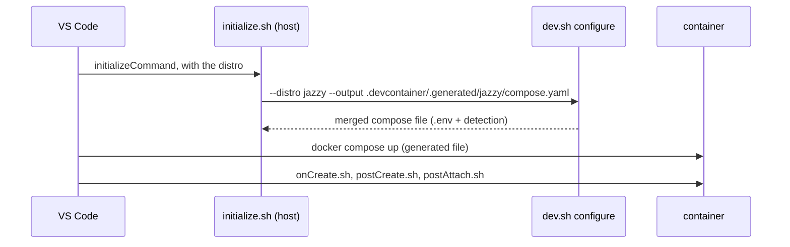
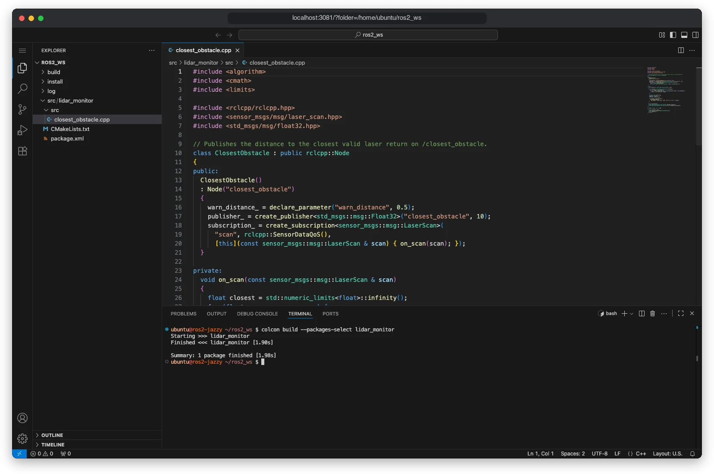

# VS Code

There are two ways to use VS Code with these containers:
- **VS Code on your machine** through a devcontainer;
- **code-server**, VS Code in the browser, which runs inside the container. It's handy on a robot.

## Devcontainers

Open the repo folder in VS Code, run **Dev Containers: Reopen in Container**, and pick a distro:

| Config | Image | Compose project |
|---|---|---|
| **ROS 2 Jazzy** | `h3ct0rdcc/ros2_dev:jazzy-<TARGET>` | `ros2_dev_jazzy` |
| **ROS 2 Humble** | `h3ct0rdcc/ros2_dev:humble-<TARGET>` | `ros2_dev_humble` |
| **ROS 2 Lyrical** | `h3ct0rdcc/ros2_dev:lyrical-<TARGET>` | `ros2_dev_lyrical` |

The configs live in [.devcontainer/](../.devcontainer), one folder per distro.

### Same setup as `dev.sh`

A devcontainer uses the same settings and detection as `./dev.sh`, so GPU, rootless Docker, network and devices are handled the same way:



To change something, edit `.env` and run **Dev Containers: Rebuild Container**. For example, to test without the GPU on an NVIDIA machine:

```bash
echo GPU=none >> .env
```

The devcontainer and `./dev.sh` share the same container name and compose project. Use one or the other for a given distro at a time.

### What runs when

| Step | Script | Does |
|---|---|---|
| `initializeCommand` (host) | [.devcontainer/initialize.sh](../.devcontainer/initialize.sh) | writes `.devcontainer/.generated/<distro>/compose.yaml` |
| `onCreateCommand` | [/onCreate.sh](../configs/devcontainer/onCreate.sh) | nothing yet; a hook for your own setup |
| `postCreateCommand` | [/postCreate.sh](../configs/devcontainer/postCreate.sh) | `apt-get update`, `rosdep install` and `colcon build` of the workspace |
| `postAttachCommand` | [/postAttach.sh](../configs/devcontainer/postAttach.sh) | clears stale X11 sockets |

VS Code waits for `postCreateCommand`, so the first open of a large workspace takes as long as its first build.

### User and files

The VS Code session runs as the container's user: `ubuntu` normally, `root` under rootless Docker. Under rootless Docker, the container's root is your host user, so files in `local_mount` stay yours either way. See [Rootless Docker](hosts.md#rootless-docker-and-podman).

### Extensions and settings

Each config installs these extensions in the container:

- **Python:** Python, Pylance, debugpy, Black, Python Environments, Python Indent, autoDocstring;
- **C++:** C/C++, C/C++ Extension Pack, C/C++ Themes, CMake Tools;
- **ROS:** Robotics Developer Environment (ROS 2, URDF editor);
- **Other:** GitLens, Jinja.

Settings point Python at the image's venv (`/home/ubuntu/.py3/bin/python`) and keep CMake Tools from configuring on its own, since colcon builds the workspace. The image also ships `~/.vscode` ([configs/devcontainer/vscode](../configs/devcontainer/vscode)) with C++ IntelliSense paths for ROS and tasks such as `colcon build`, `rviz2` and opening the VNC desktop.

To add your own extensions, edit `customizations.vscode.extensions` in the distro's `devcontainer.json`. The three configs differ only in the distro, so keep them in sync.

## code-server

The `desktop` and `full` images run code-server on port 3081:

```text
http://localhost:3081/?folder=/home/ubuntu/ros2_ws
```



- It has no password unless `CODE_SERVER_PASSWORD` is set.
- Its extensions come from [Open VSX](https://open-vsx.org), not the Microsoft marketplace. Install them from its Extensions view.
- On a robot with host networking, open `http://<robot-ip>:3081` from your laptop.
